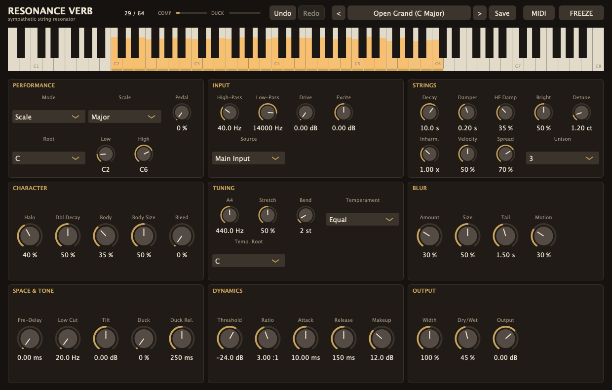
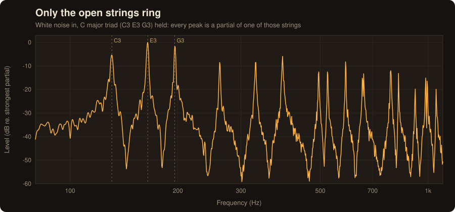
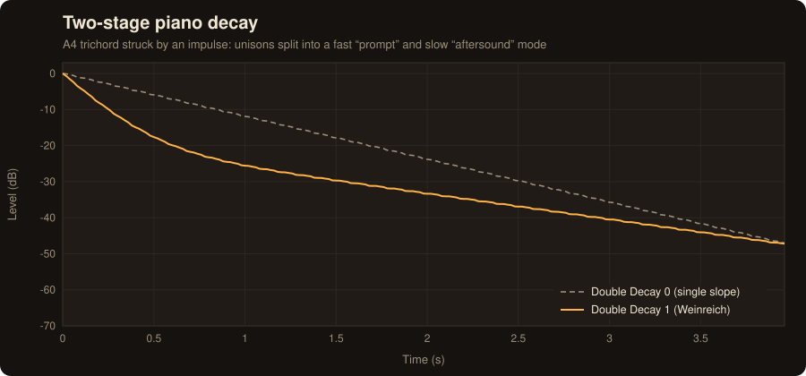
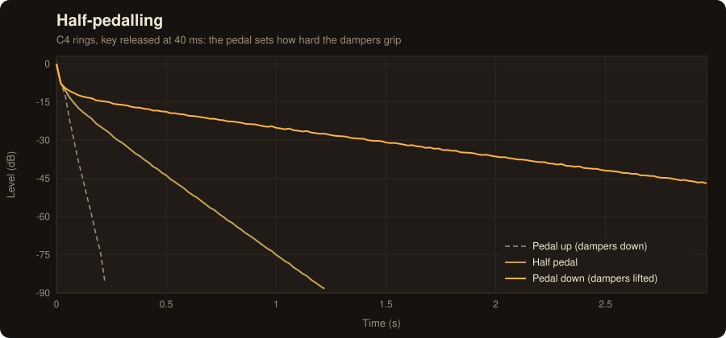
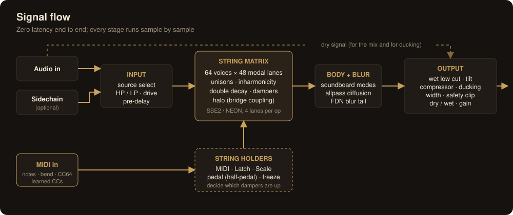
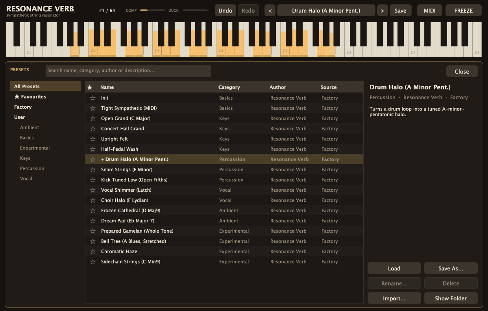
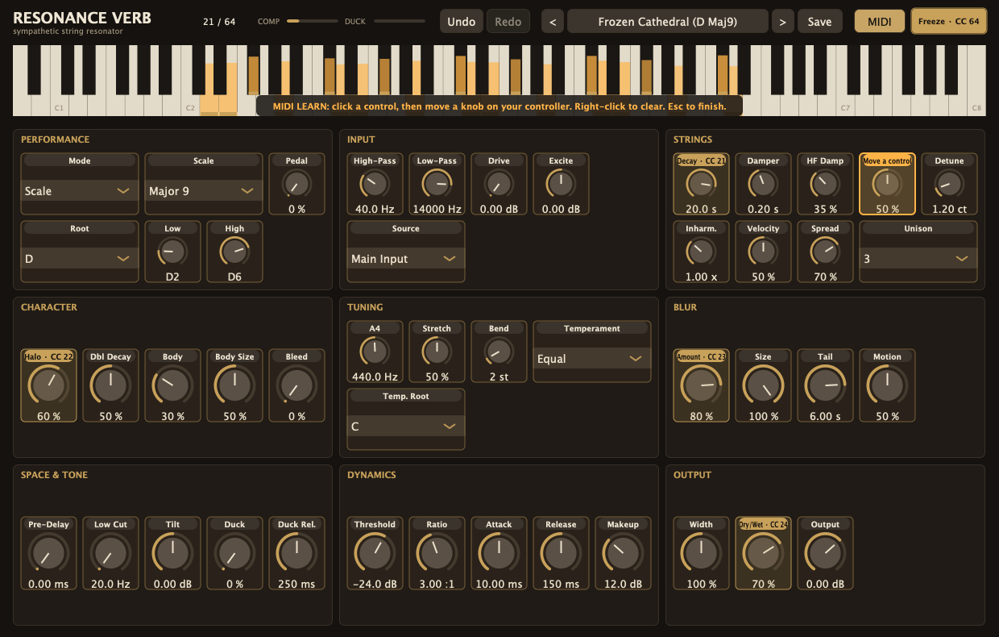

# Resonance Verb

**A sympathetic-resonance reverb: a virtual, pedal-free piano body that rings only on the notes you choose.**

[](https://github.com/mtyas/resonance-verb/actions/workflows/build.yml)


[](LICENSE)



Shout into an open grand piano with the sustain pedal down and the strings answer back: every string whose
pitch is in your voice rings in sympathy. Resonance Verb gives you that, with control over **which** strings are
undamped. Play a chord on MIDI (or pick a scale) to lift those dampers, and run any audio through it: vocals,
drums, guitar, synths. Only the frequencies that match the open strings and their overtones bloom; everything
else dies away.

It isn't a sampler and it isn't a conventional algorithmic reverb. It is a physically-modelled bank of piano
strings, with real string stiffness, multi-string unisons that beat against each other, a two-stage decay, a
soundboard, and strings that pass energy to one another through the bridge.

## Features

**Sympathetic string engine**
- Up to 64 notes at once, each with 1–3 detuned unison strings and up to 48 partials, all modelled as
  click-free modal resonators. They're vectorised with SSE2/NEON, so 48 notes use about 6 % of one CPU core.
- Real piano physics: stiff-string inharmonicity `fₙ = n·f₀·√(1+Bn²)`, frequency-dependent damping,
  Weinreich double decay, octave stretch, and bridge coupling between strings ("Halo").
- Soundboard body, plus "Bleed": the muffled ring of a piano with every damper down.

**Playing the strings**
- **MIDI**: hold notes to lift dampers. **Latch**: play a chord once and it stays open. **Scale**: pick a key and
  scale (22 scales and chords), no MIDI needed.
- Velocity, pitch bend, continuous **half-pedal** (CC64 or an automatable Pedal control) and **Freeze**.
- A **sidechain** input can play the strings while the main input passes through dry.
- Tuning: A4 reference, Equal / Just / Pythagorean / ¼-comma Meantone / Werckmeister III, and octave stretch.

**Sound shaping and mixing**
- Input high/low-pass and drive; **Blur** (modulated allpass diffusion and a short diffuse tail).
- Wet low cut and tilt, a compressor with makeup gain, **ducking** under the dry signal, pre-delay, and stereo
  width with the bass on the left and the treble on the right, like a real keyboard.
- Zero latency throughout.

**Workflow**
- **Undo / redo** for every edit and preset load (⌘Z / ⇧⌘Z, Ctrl+Z / Ctrl+Y).
- **Preset browser** with 17 factory presets, user presets, categories, search, favourites, import and Show Folder.
- **MIDI learn on every control**, with mappings saved in your session and an optional default mapping.
- An 88-key display showing which strings are open and how hard each one is ringing.

## What it does, measured

Noise in, C major triad held: only the partials of C3, E3 and G3 come out.



| Two-stage decay (Double Decay) | Half-pedalling |
|---|---|
|  |  |

All of these figures are produced from the engine itself (`rv_render --export-plots`); see
[docs/DSP.md](docs/DSP.md) for how it works and how it is verified.

## How it works



## Install

Download the zip for your platform from **[Releases](https://github.com/mtyas/resonance-verb/releases)** and copy
the plugin(s) you use:

| Platform | VST3 | CLAP | Other |
|---|---|---|---|
| macOS | `~/Library/Audio/Plug-Ins/VST3/` | `~/Library/Audio/Plug-Ins/CLAP/` | AU: `~/Library/Audio/Plug-Ins/Components/` |
| Windows | `C:\Program Files\Common Files\VST3\` | `C:\Program Files\Common Files\CLAP\` | Standalone `.exe` |
| Linux | `~/.vst3/` | `~/.clap/` | LV2: `~/.lv2/` |

> **macOS:** the builds are not notarised. After copying, clear the quarantine flag once:
> ```bash
> xattr -dr com.apple.quarantine ~/Library/Audio/Plug-Ins/{VST3,Components,CLAP}/Resonance\ Verb.*
> ```
> **Windows** may show a SmartScreen prompt for the Standalone app.

## Quick start

1. Put Resonance Verb on a track or bus with audio (vocals and drums are a great place to start).
2. Choose how the strings get opened:
   - **No MIDI?** Load *Open Grand (C Major)* or *Drum Halo* from the preset menu. Those use **Scale** mode.
   - **With MIDI**: route a MIDI track into the plugin and hold chords. **Latch** keeps them open hands-free.
3. Shape it: **Decay** for length, **Halo** and **Body** for piano character, **Blur** for wash, and **Duck** to
   keep the dry signal clear.

Host-by-host MIDI routing, every parameter, and tips are in the **[User Guide](docs/USER_GUIDE.md)**.

| Preset browser | MIDI learn |
|---|---|
|  |  |

## Documentation

- [User Guide](docs/USER_GUIDE.md): controls, modes, presets, MIDI learn, host setup and troubleshooting.
- [DSP & Architecture](docs/DSP.md): the string model, its physics and stability, and the verification results.
- [Building from source](docs/BUILDING.md): toolchains, targets, tests, validators and CI.
- [Changelog](CHANGELOG.md)

## Building

```bash
cmake -B build -G Ninja -DCMAKE_BUILD_TYPE=Release
cmake --build build --target ResonanceVerb_All ResonanceVerb_CLAP rv_render rv_plugin_tests
```

CMake fetches JUCE 9 and clap-juce-extensions automatically. Every push is built and tested on macOS, Windows and
Linux by [GitHub Actions](.github/workflows/build.yml), and tagging `v*` publishes a release. See
[docs/BUILDING.md](docs/BUILDING.md).

## Licence

Resonance Verb is free software, licensed under the **GNU Affero General Public License v3.0 or later**
([LICENSE](LICENSE)). It is built with [JUCE](https://juce.com), which is used here under its AGPLv3 open-source
licence. It also uses [CLAP](https://github.com/free-audio/clap) and
[clap-juce-extensions](https://github.com/free-audio/clap-juce-extensions) (MIT), and the VST3 SDK bundled with
JUCE (MIT). VST is a registered trademark of Steinberg Media Technologies GmbH. Audio Unit is a trademark of
Apple Inc.

Copyright © 2026 Matthew Tyas.
