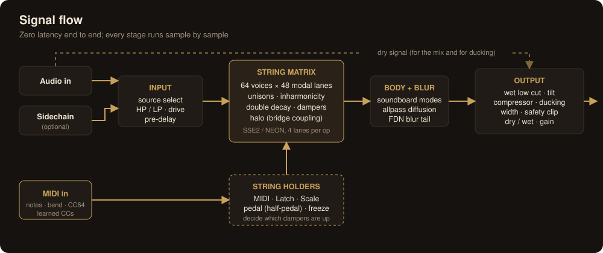
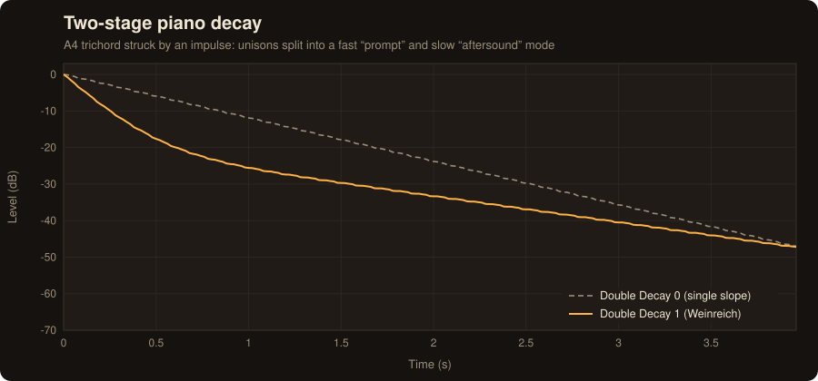
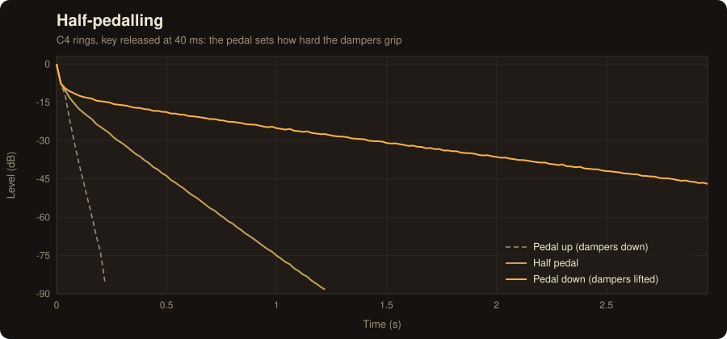

# DSP & Architecture

The DSP core (`Source/dsp/`) is plain C++17 with no JUCE dependency, so it can be compiled and verified on its own
(`tests/render_test.cpp`). The JUCE layer (`Source/*.cpp`) adds parameters, presets, MIDI learn, undo and the UI.



| File | Role |
|---|---|
| `dsp/ResonatorBank.h` | The string matrix: voices, string physics, halo coupling, and the SIMD inner loop |
| `dsp/InputStage.h` | Source select, 4th-order HP/LP (TPT SVF), asymmetric drive, excitation gain |
| `dsp/SoundboardBody.h` | 10-mode soundboard (Body) and direct board excitation (Bleed) |
| `dsp/Diffuser.h` | Blur: modulated Thiran-interpolated allpasses and a 4-line FDN tail |
| `dsp/OutputStage.h` | Wet EQ, compressor, ducking, width, safety soft-clip, mix |
| `dsp/ResonanceVerbCore.h` | The whole chain, plus the logic for which strings are held (MIDI / Latch / Scale), pedal and freeze |
| `dsp/Tuning.h`, `dsp/Scales.h` | Temperaments, stretch, the per-note table hook; scale and chord tables |
| `dsp/SimdVec.h` | 4-wide float SIMD: SSE2 / NEON / scalar |

## The string matrix

### Modal lanes
Every partial of every unison string is a **complex one-pole resonator**:

```
y[n] = r·e^{jω}·y[n−1] + b·x[n],      output = Re(y)
```

This is equivalent to a two-pole band-pass filter, but changing ω (pitch bend) or r (damper, pedal, freeze) only
changes the rotation. The stored vibration carries on unchanged, so there are no clicks and no coefficient
transients, which biquads produce when their coefficients change. Every lane is independent, so four lanes fit
in one SSE/NEON register with no shuffles.

### Voices
A voice (one MIDI note) owns 48 lanes, divided like a real piano's stringing: 1 string × 48 partials below A♯1,
2 × 24 in the tenor, and 3 × 16 above. Lanes are ordered partial-first, so partials above 0.45·fs fall at the end
and are skipped. Treble notes are cheap. Up to **64 voices**: held notes plus ringing tails. A released voice frees
itself once it falls below −120 dBFS. The quietest released voice is stolen first; if none is released, the
oldest is taken.

### Physics
- **Inharmonicity** `fₙ = n·f₀·√(1 + B·n²)`, with B following the register (≈1e-4 in the bass, rising to ≈1.7e-2 at
  C8), scaled by *Inharm.*
- **Loss**: `σₙ = (σ₀ + k_hf·fₙ²)·m`, where `σ₀ = ln(1000)/T60(note)` (Chaigne–Askenfelt form; T60 shortens up
  the keyboard).
- **Dampers**: a key-up string's loss interpolates **log-linearly** between "lifted" and "down" according to the
  pedal (0.2–0.8 is the half-pedal zone). A damper also *decouples* the string from the soundboard: its input
  coupling is scaled by how far it is lifted. Without that, a released string fed continuous audio would never
  fall silent, and its voice would never be freed.
- **Double decay** (Weinreich): string 0 of a bi- or trichord becomes the bridge-symmetric "prompt" mode (loss
  ×(1+3d), coupling ×(1+d)); the others become "aftersound" modes (loss ×(1−0.4d), coupling ×(1−0.5d)).
- **Unisons** are detuned by ±*Detune* cents, plus a fixed per-note offset, so different notes beat at different
  rates.
- **Input coupling** `b = (1−r)^0.75`. This sits between "unit peak gain" `(1−r)` and "unit noise power"
  `√(1−r²)`, so tonal and broadband material both land in a usable range at any Decay setting.



### Halo: bridge coupling that can't run away
The first version fed every string with the other strings' output. That is a feedback network, and with
Inharmonicity, Stretch and Detune at 0 the octave partials coincide exactly and it ran away by +50 dB.
Bounding the gain wasn't enough: N exactly coincident strings form a loop with gain ∝ N−1.

The shipped design is **feed-forward**. Each of a voice's lowest 24 lanes has a second, *sympathetic* state with
the same pole. It is driven by the **direct** output of the *other* strings from one 64-sample sub-block earlier
(about 1.3 ms; the bridge isn't instantaneous either). Sympathetic states never feed the coupling bus, so there
is no loop, and it is stable for every setting. Coincident partials make the sympathetic response swell and then
decay (a double pole), which is how a real piano's sympathetic strings build up after a note.
The stress tests run 56 strings and a seven-octave stack at Halo 1 with exactly coincident partials. Both stay
bounded (no swell above the start level) and decay.

At the default Halo of 30 %, an open C5 picks up −24 dB relative to a ringing C4; at 100 % it is −13.5 dB.

### Freeze
Freeze sets each lane's loss to a 300-second T60 and its coupling to 0. It deliberately isn't r = 1: float
rounding of the pole (about 6e-8 per sample) must stay well below the decay (about 4.8e-7 per sample), so a frozen
chord can never grow.



## The rest of the chain

- **Input**: source select (main / sidechain / both; falls back to main if the sidechain isn't connected),
  4th-order Butterworth HP and LP (TPT state-variable filters, safe to modulate), asymmetric `tanh` drive with
  unity small-signal gain, excitation gain, and a smoothed pre-delay.
- **Soundboard**: 10 low-Q peak-normalised band-passes (62 Hz–1.65 kHz × *Body Size* scale) panned alternately.
  Driven by the strings (*Body*) and/or directly by the input (*Bleed*). With Bleed at 0 and no strings open, the
  output is exactly silent.
- **Blur**: 6 Schroeder allpasses per side, with different prime-ish lengths on the left and right
  (4–23 ms × Size). They use **first-order Thiran (allpass) interpolation**, so they lose no energy even while
  modulated (linear interpolation lost 5 dB). Motion uses slow, unrelated LFOs at a fixed ±0.3 ms depth (under
  1 cent of drift at the default). The tail is a 4-line Hadamard FDN with high-frequency damping in the loop.
  Amount 0 is a bit-exact bypass.
- **Output**: wet low cut (12 dB/oct) and first-order tilt, then a stereo-linked soft-knee feed-forward
  compressor, ducking driven by the dry signal (up to −24 dB), M/S width, a transparent soft clip (linear below
  0.8, smooth up to 1.0), and the dry/wet mix.

**Latency: none.** Processing is sample by sample, coefficients update every 64 samples, and MIDI is applied at
the exact sample it arrives (the block is split at each event).

## Verification

`rv_render` (47 checks) and `rv_plugin_tests` (33 checks) run on every CI build. Selected results (48 kHz):

| Check | Result |
|---|---|
| Held note's harmonics vs. ±1 semitone (white noise in) | ≥ 33.6 dB |
| No strings open | output exactly 0 |
| A1 10th partial (B = 1.09e-4) | predicted 552.98 Hz, measured 552.95 Hz |
| Held T60 = 4 s | −15.03 dB/s (expected −15.00) |
| HF loss | partial 1 −15.9 dB/s, partial 8 −72.1 dB/s |
| +2 st pitch bend on A4 | 493.88 Hz |
| Half-pedal decay | 73 dB/s (predicted 73) |
| Released voices under continuous input | all 24 freed 0.74 s after release |
| Freeze, then +20 dB of new input | −0.42 dB over 2 s (input ignored) |
| Double decay on: early / late slope | 36.1 / 7.2 dB/s (off: 11.9 / 11.9) |
| Halo 1, exact partials, 56 strings / 7 octaves | bounded, then decays 26 / 11 dB |
| Diffuser energy, L/R correlation | ±0.00 dB, 0.03 |
| Ducking depth | 24.0 dB (expected 24) |
| NEON vs. scalar, SSE2 vs. NEON | bit-identical; −100 dB (libm rounding) |
| pluginval (strictness 10, incl. GUI), auval | pass |

**CPU** (full chain, Apple Silicon, NEON, 48 kHz): 1 note 0.4 %, 8 notes 1.2 %, 24 notes 3.0 %, 48 notes 5.7 % of
one core.

### Bugs the tests caught during development
These are kept here because each one now has a regression test:
- A damped string fed continuous audio never went silent, so released voices piled up until all 64 stayed alive.
- Feedback halo coupling was unstable with exactly coincident partials (see above).
- Linear interpolation inside the modulated allpasses lost 5 dB of energy.
- `AudioParameterBool` keeps raw fractional values that a state restore can miss (pluginval). Freeze is now a
  two-state choice parameter.

## Ideas for the future
- An AVX 8-wide path (48 lanes is divisible by 8) with runtime CPU dispatch.
- MTS-ESP / Scala tuning (`Tuning::noteHz` is already there).
- MPE / per-note pitch bend (a bend ratio per voice).
- Smoother automation of layout parameters (Decay, Brightness, …) by interpolating instead of rebuilding.
